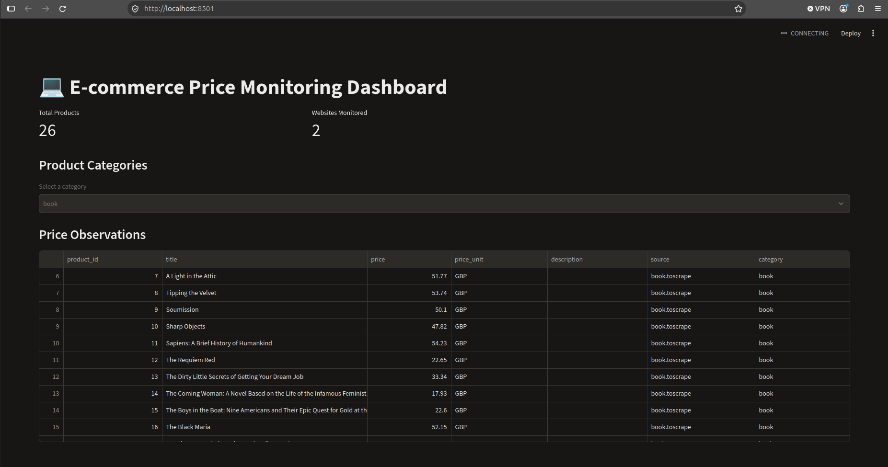

# A demo of data crawling from e-commerce websites

## Objectives

This is a demo of data crawing from e-commercial websites, including:
- Collects product information from 2 e-commerce websites.
- Extracts product names, prices and specifications.
- Stores the information in PostgreSQL.
- Displays results in a dashboard.

Use public product data from websites that permit automated access, or authorized APIs and demo storefronts.

Two websites are used in this demo includes:
- https://books.toscrape.com/
- https://webscraper.io/test-sites/pagination

The results are diplayed on a dashboard as follows:

